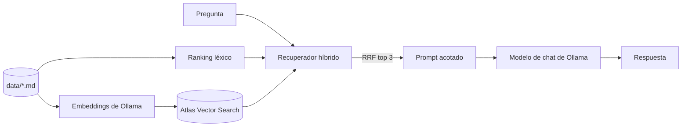

# career-agent

Asistente con generación aumentada por recuperación (RAG) que responde preguntas sobre mi perfil profesional usando solo los archivos Markdown de `data/`. Funciona de forma local con Ollama (chat y embeddings), guarda los vectores en MongoDB Atlas Vector Search y combina un ranking léxico con uno semántico mediante Reciprocal Rank Fusion; luego un único nodo de LangGraph arma un prompt acotado en tokens y genera una respuesta basada en la evidencia. Para indexar los documentos ejecuta `python src/agente-carrera/agenTEMP.py --index`, para levantar el servidor usa `langgraph dev` y para correr las pruebas usa `python -m unittest discover -s test`.

