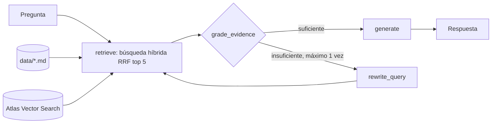

# career-agent

Asistente con generación aumentada por recuperación (RAG) que responde preguntas sobre mi perfil profesional usando solo los archivos Markdown de `data/`. Usa la API de Gemini para el chat y los embeddings, guarda los vectores en MongoDB Atlas Vector Search y combina un ranking léxico con uno semántico mediante Reciprocal Rank Fusion; luego un grafo de LangGraph aplica Corrective RAG: evalúa si la evidencia contiene el dato pedido, reformula la consulta y vuelve a buscar una vez si no alcanza, y solo entonces genera una respuesta basada en la evidencia. Instala el proyecto con `pip install -r requirements.txt -e .`, define `GOOGLE_API_KEY` y las variables de MongoDB en `.env`, indexa los documentos con `python -m career_agent.cli --index`, haz una consulta con `python -m career_agent.cli "¿Qué proyectos usan MongoDB?"`; para levantar el API HTTP (`POST /ask`) usa `uvicorn career_agent.api:app` o el `Dockerfile`, para explorar el grafo usa `langgraph dev`, para correr las pruebas usa `python -m unittest discover -s test` y para medir el retrieval (Hit@1 y MRR sobre `evals/retrieval_questions.json`) usa `python -m career_agent.evals` y para medir las respuestas finales (`evals/answer_questions.json`) usa `python -m career_agent.evals --answers`.

## Tecnologías

| Área | Tecnología | Uso |
|---|---|---|
| Lenguaje | Python 3.12 | Todo el proyecto |
| Modelos | Gemini `gemini-3.5-flash-lite` | Generación de respuestas |
| Modelos | Gemini `gemini-embedding-2` (768 dimensiones) | Embeddings de documentos y consultas |
| Orquestación | LangGraph 1.2 | Grafo Corrective RAG (`retrieve`, `grade_evidence`, `rewrite_query`, `generate`) |
| Orquestación | LangChain 1.4 y langchain-core 1.7 | Mensajes, documentos, salida estructurada y puertos (`BaseChatModel`, `Embeddings`) |
| Integraciones | langchain-google-genai 4.4 | Cliente de chat y embeddings de Gemini |
| Integraciones | langchain-mongodb 0.12 y PyMongo 4.19 | Adaptador de MongoDB Atlas Vector Search |
| Procesamiento | langchain-text-splitters 1.1 | División de los Markdown por sección (`##`) |
| Base de datos | MongoDB Atlas Vector Search | Índice vectorial con filtro por modelo de embeddings |
| API | Starlette 1.10 y Uvicorn 0.54 | `POST /ask` con CORS y rate limit |
| Configuración | python-dotenv 1.2 | Carga de variables desde `.env` |
| Pruebas | unittest | Pruebas unitarias con dobles de prueba |
| Despliegue | Docker y Railway | Imagen del API y hosting |
