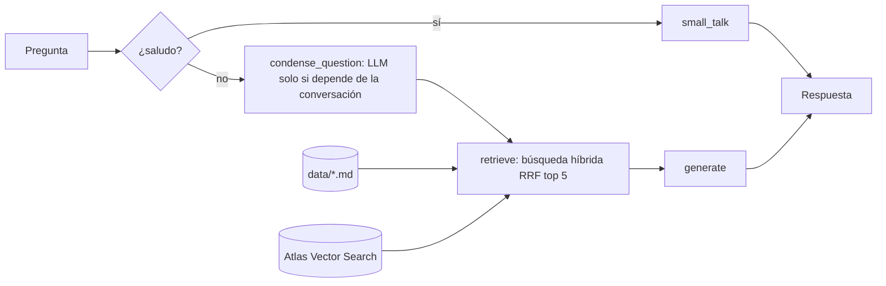

# career-agent

Asistente con generación aumentada por recuperación (RAG) que responde preguntas sobre mi perfil profesional usando solo los archivos Markdown de `data/`. Usa la API de Gemini para el chat y los embeddings, guarda los vectores en MongoDB Atlas Vector Search y combina un ranking léxico con uno semántico mediante Reciprocal Rank Fusion; luego un grafo de LangGraph reescribe la pregunta como independiente solo si depende de la conversación, busca una vez y genera la respuesta basada en la evidencia con una sola llamada al modelo. Instala el proyecto con `pip install -r requirements.txt -e .`, define `GOOGLE_API_KEY` y las variables de MongoDB en `.env`, indexa los documentos con `python -m career_agent.cli --index`, haz una consulta con `python -m career_agent.cli "¿Qué proyectos usan MongoDB?"`; para levantar el API HTTP (`POST /ask`) usa `uvicorn career_agent.api:app` o el `Dockerfile`, para explorar el grafo usa `langgraph dev`, para correr las pruebas usa `python -m unittest discover -s test` y para medir el retrieval (Hit@1 y MRR sobre `evals/retrieval_questions.json`) usa `python -m career_agent.evals` para medir las respuestas finales (`evals/answer_questions.json`) usa `python -m career_agent.evals --answers` y para medir los seguimientos de conversación usa `--followups`; agrega `--full-context` a cualquiera de los dos para comparar contra la alternativa sin búsqueda.

## RAG contra contexto completo

Todo el perfil suma unos 16.000 tokens (11 archivos), así que cabe completo en el contexto de Gemini. Lo medí con los mismos evals, el mismo prompt y el mismo modelo, cambiando solo cómo se obtiene la evidencia:

| Métrica | RAG actual | Corrective RAG (versión anterior) | Contexto completo |
|---|---|---|---|
| Respuestas correctas (15 preguntas) | 11/15 | 13/15 (11/15 al repetirlo junto al RAG actual) | 15/15 |
| Seguimientos que aportan datos nuevos (3) | 2/3 | 1/3 | 0/3 |
| Latencia promedio | 3,4 s | 12,8 s (4,9 s sin esperas por cuota) | 5,3 s |
| Llamadas al modelo por pregunta | 1 a 2 | 2 a 4 | 1 |
| Infraestructura | MongoDB Atlas y embeddings | MongoDB Atlas y embeddings | Ninguna |

Siendo honesto: con este tamaño de corpus, el contexto completo responde mejor las preguntas directas. Las que falla el RAG son preguntas ambiguas desde que agregué más proyectos ("¿Cuántas suites de pruebas implementó?" tiene candidatos en tres documentos) o datos que el retrieval no trae entre los cinco primeros. El RAG gana en seguimientos, y la muestra es chica. Lo mantengo porque el objetivo del proyecto es construir y medir un retrieval de verdad, y porque escala si el corpus crece; el flag `--full-context` deja la comparación siempre a mano. Corrí los evals en el tier gratuito de Gemini, limitado a 15 requests por minuto, así que las latencias son orientativas y la variación entre corridas es de una o dos respuestas.

## Decisiones de diseño

- **Una sola fuente de verdad.** El contenido vive en `data/*.md`, versionado en git junto a los evals. MongoDB no guarda nada propio: es un índice derivado. El indexado es incremental (solo agrega chunks que no existen y borra los que ya no están en el archivo) y cada documento guarda el `embedding_model`, así que cambiar de modelo reindexa sin mezclar vectores incompatibles.
- **Búsqueda híbrida con RRF.** La búsqueda léxica encuentra nombres propios y siglas ("BigQuery", "SendGrid") y la vectorial encuentra paráfrasis ("datos en la nube"). Las combino con Reciprocal Rank Fusion (k = 60) en lugar de ponderar scores, porque los puntajes de cada método no son comparables. Eval de retrieval actual: Hit@1 75%, Hit@5 100%, MRR 0,875 sobre 12 preguntas.
- **Protección contra desincronización.** La búsqueda léxica usa los Markdown que vienen en la imagen Docker y la vectorial usa Atlas. Si Atlas devuelve un chunk de un archivo cuyo texto ya no coincide con la versión actual, el retriever lo descarta (`DocumentationRetriever.search`).
- **Una llamada al modelo por pregunta.** Antes el grafo usaba Corrective RAG: evaluaba la evidencia con el modelo y, si no alcanzaba, reformulaba y volvía a buscar. Medí los tiempos por nodo en producción y el evaluador se llevaba entre el 25% y el 50% de cada respuesta sin mejorar los evals (11/15 con y sin él), y con 2 a 4 llamadas por pregunta el límite de 15 requests por minuto se agotaba con cuatro preguntas. Lo quité: la generación ya dice con naturalidad cuando un dato no está. La pregunta se condensa con el modelo solo si depende de la conversación (`depends_on_conversation`: seguimientos cortos, pronombres o una "y" inicial).
- **Puertos sin carpetas por capa.** `DocumentIndex`, `DocumentationSource` y `DocumentSplitter` son `Protocol`, y `MongoAtlasIndex` es el único adaptador. Las pruebas usan dobles en memoria y no gastan cuota. No separé carpetas por capa porque con un solo adaptador solo agregaba indirección.
- **Entornos separados.** Desarrollo y producción usan colecciones distintas de Atlas, así que puedo indexar y correr evals sin tocar el chat publicado. Límite conocido: si agrego o modifico un archivo, tengo que indexar la colección de producción después del deploy (`railway run python -m career_agent.cli --index`).

## Tecnologías

| Área | Tecnología | Uso |
|---|---|---|
| Lenguaje | Python 3.12 | Todo el proyecto |
| Modelos | Gemini `gemini-3.5-flash-lite` | Generación de respuestas |
| Modelos | Gemini `gemini-embedding-2` (768 dimensiones) | Embeddings de documentos y consultas |
| Orquestación | LangGraph 1.2 | Grafo RAG (`small_talk`, `condense_question`, `retrieve`, `generate`) con tiempos por nodo en los logs |
| Orquestación | LangChain 1.4 y langchain-core 1.7 | Mensajes, documentos, salida estructurada y puertos (`BaseChatModel`, `Embeddings`) |
| Integraciones | langchain-google-genai 4.4 | Cliente de chat y embeddings de Gemini |
| Integraciones | langchain-mongodb 0.12 y PyMongo 4.19 | Adaptador de MongoDB Atlas Vector Search |
| Procesamiento | langchain-text-splitters 1.1 | División de los Markdown por sección (`##`) |
| Base de datos | MongoDB Atlas Vector Search | Índice vectorial con filtro por modelo de embeddings |
| API | Starlette 1.10 y Uvicorn 0.54 | `POST /ask` con CORS y rate limit |
| Configuración | python-dotenv 1.2 | Carga de variables desde `.env` |
| Pruebas | unittest | Pruebas unitarias con dobles de prueba |
| Despliegue | Docker y Railway | Imagen del API y hosting |
