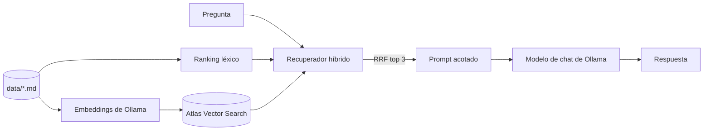

# career-agent

Asistente con generación aumentada por recuperación (RAG) que responde preguntas sobre mi perfil profesional usando solo los archivos Markdown de `data/`. Funciona de forma local con Ollama (chat y embeddings), guarda los vectores en MongoDB Atlas Vector Search y combina un ranking léxico con uno semántico mediante Reciprocal Rank Fusion; luego un único nodo de LangGraph arma un prompt acotado en tokens y genera una respuesta basada en la evidencia. Instala el proyecto con `pip install -r requirements.txt -e .`, indexa los documentos con `python -m career_agent.cli --index`, haz una consulta con `python -m career_agent.cli "¿Qué proyectos usan MongoDB?"`; para levantar el servidor usa `langgraph dev`, para correr las pruebas usa `python -m unittest discover -s test` y para medir el retrieval (Hit@1 y MRR sobre `evals/retrieval_questions.json`) usa `python -m career_agent.evals`.

